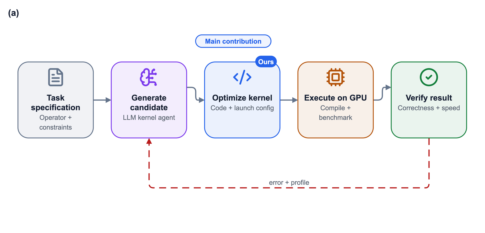
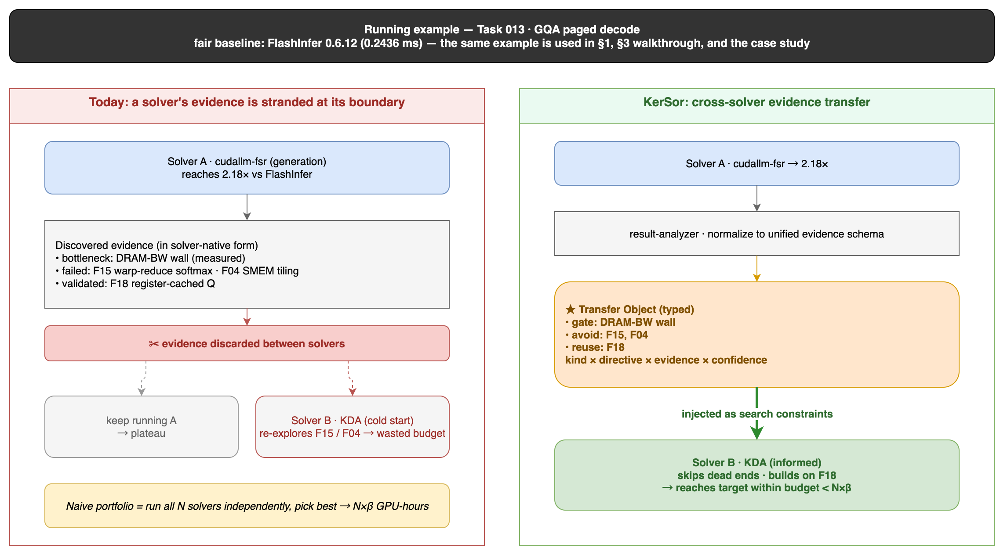
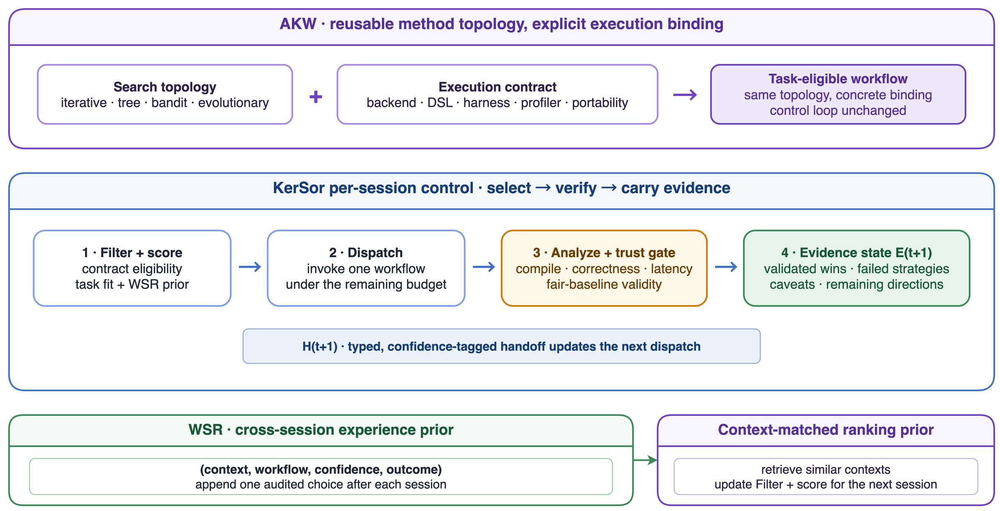
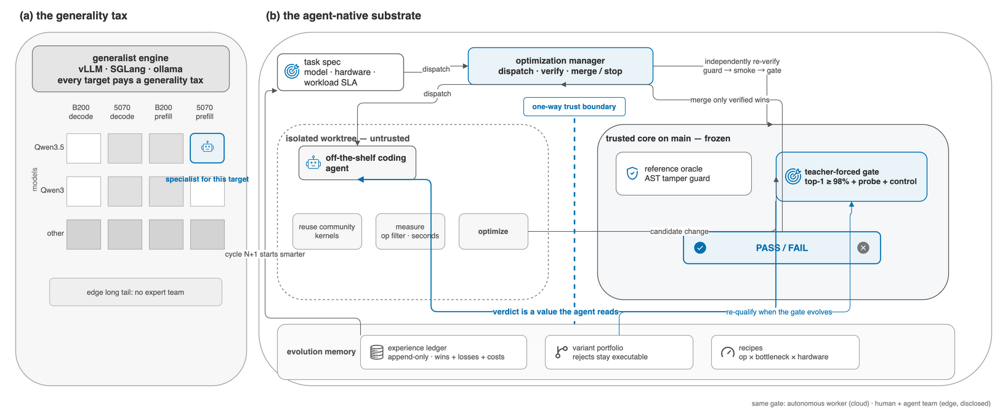

# Editable examples

These cases show different scientific-figure jobs while preserving Draw.io
source, vector output, and a review preview.

## Kernel agent optimization loop

An end-to-end example generated by this repository's structured bridge. It
includes the Figure Contract, paper palette, JSON spec, editable Draw.io source,
icon manifest, SVG/PDF masters, PNG preview, caption, and validation record.

Design pattern: a five-stage horizontal scan with one bounded dashed feedback
loop. Color indicates stable semantic roles rather than arbitrary pipeline
enumeration.

## KerSor motivated example

Source: [qhy991/KerSor](https://github.com/qhy991/KerSor).

Design pattern: a before/after two-panel argument. The figure makes the research
motivation concrete through matched geometry and a small number of highlighted
differences instead of explaining the problem only in prose.

## KerSor control state

Source: [qhy991/KerSor](https://github.com/qhy991/KerSor).

Design pattern: separate topology, control state, and experience prior into
readable regions, then connect them with a deliberately bounded control path.
The editable source is useful for revising terminology and ownership boundaries
as the system design evolves.

## Agent-native engine

Source:
[qhy991/Agents-Native-Engine](https://github.com/qhy991/Agents-Native-Engine).

Design pattern: contrast the generality tax with an agent-native substrate.
The wide composition establishes the problem before introducing the system
abstraction.

## Reuse

Use these files as composition references, not as a universal house style.
Start from the research claim and Figure Contract, adopt the relevant
archetype, and bind the result to the paper's own frozen palette.
